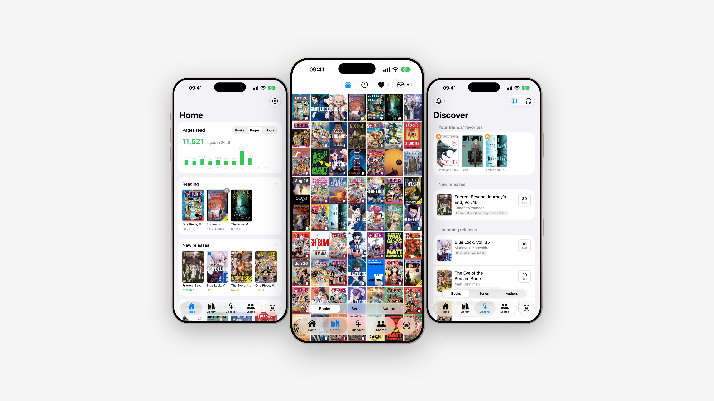
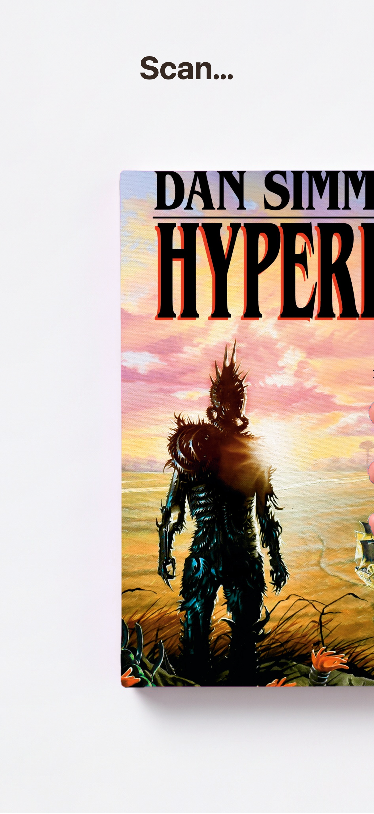
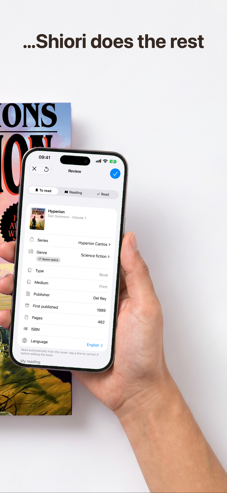
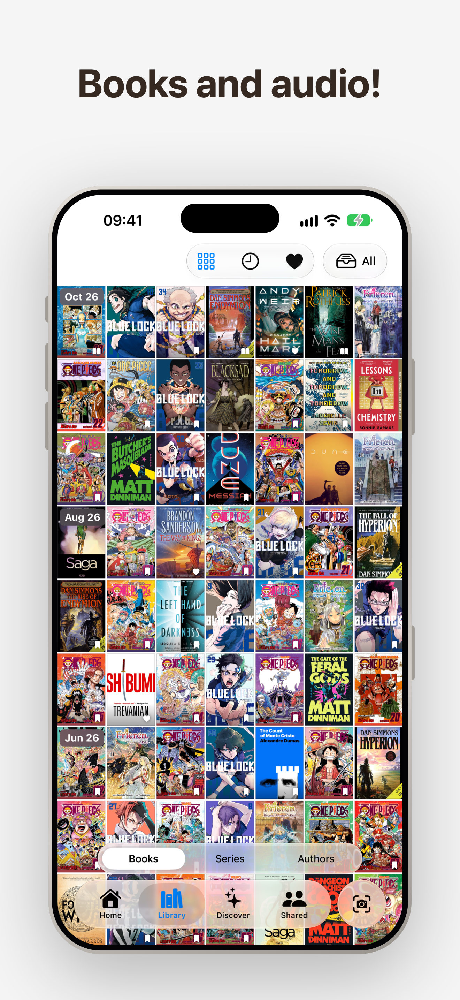
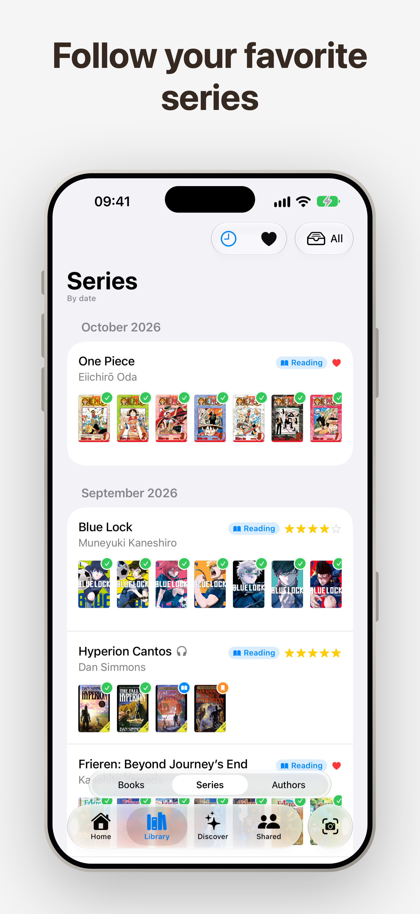
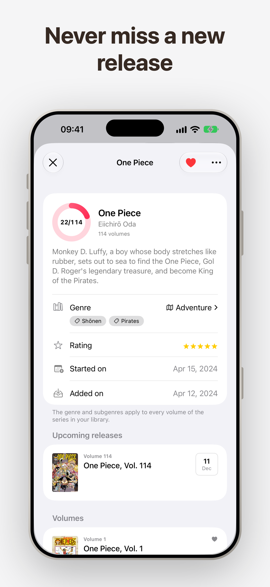
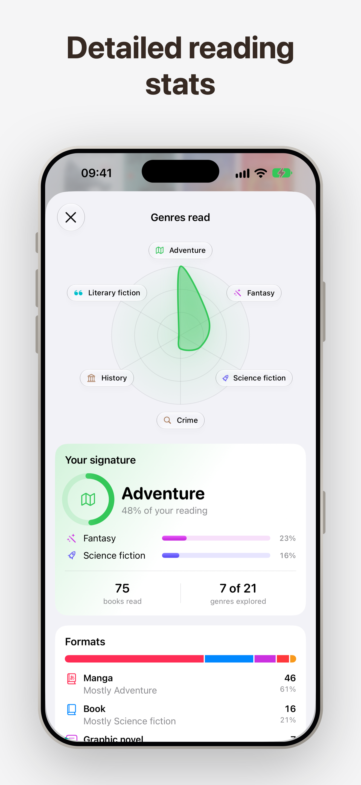
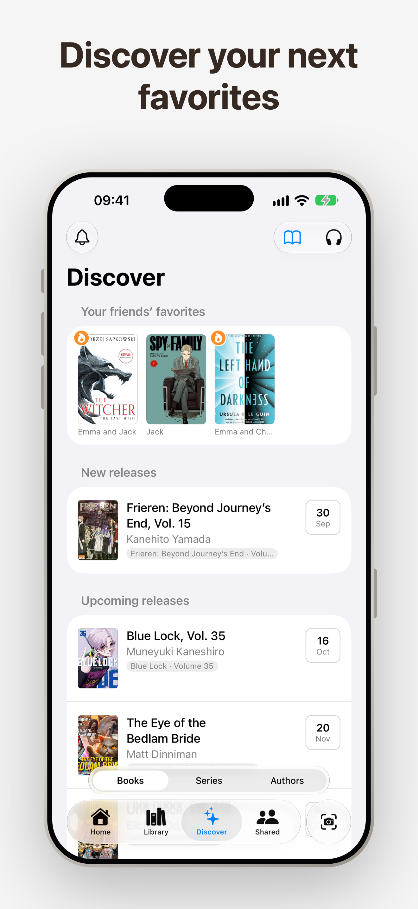
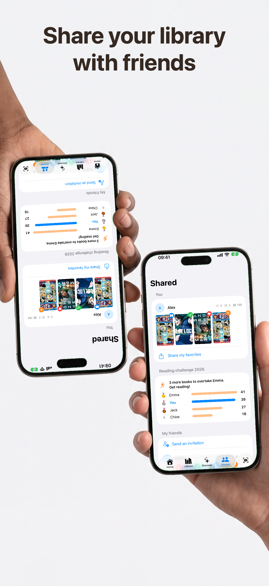

  

<h1 align="center">Shiori: Book Tracker</h1>

  <b>Scan and track your reading</b> 
  iPhone · Free, with Premium

> 栞 (*shiori*) is Japanese for a bookmark.

Shiori is your library in your pocket. Take a photo of a book cover: Shiori recognizes it and
fills in its record for you — title, author, publisher, summary, genre and series. Novels,
graphic novels, manga, comics or audiobooks: everything has its place.

---

## Snap a cover. Shiori does the rest.

  

No barcode to find, no ISBN to type. Point the camera at a cover — an old edition, a library
copy, a book with no barcode at all — and the record appears: series and volume number, genre,
publisher, first publication year, page count, language. You check it, choose whether it is
to read, being read or already read, and it joins your shelves.

- **A whole shelf at once.** Photograph a row of spines and add every book in one go.
- **Paper or screen, one book.** A paperback you also own on your Kindle stays a single record.
- **Kindle and Audible.** Connect your accounts and your existing library comes in, then stays
  in sync.

## Every book, in one place

  

Your library is a wall of covers, sorted by when you added them. Switch to your series or
your authors, show only your favorites, or only what you listen to.

- **Four states.** To read, reading, read or dropped. Reading dates follow from moving a book;
  you never type them.
- **Your opinion.** Star ratings, favorites, and a private note on every book.
- **Books and audio.** Audiobooks sit beside print, with hours listened instead of pages.
- **Some books stay yours.** Hide a book and it is never shared with anyone.

## Follow your favorite series

  

Your books group themselves under the series they belong to, volume by volume. Open one and
you see the whole series: the volumes you own, the ones you are missing, and the next one
announced, with its release date.

- **Never miss a release.** Shiori watches your series and sends you an alert the day the next
  volume comes out.
- **Waiting for a translation?** A book not yet out in your language or as an audiobook can
  tell you the day it is.

## Know your reading

  

The home screen keeps score: books read per year, pages read, hours listened, what you are
reading now and what is coming out soon. Go deeper and you get the map of the genres you read,
your reading signature, the formats you prefer, and the pile still waiting for you.

## Discover your next favorites

  

Discover is where the next book comes from:

- **Your friends' favorites**, one tap away from your own to-read pile.
- **New and upcoming releases** in the series and by the authors you read.
- **Picked for you.** Each month, a handful of books chosen from the ones you loved.
- **Prize winners** in the genres you read most.

## Share your library with friends

  

Invite your friends: you each see the other's library, favorites and current reads. Pick up an
idea from their shelves in one tap, and set each other a reading challenge for the year. Your
notes stay private, and a hidden book is never shared.

---

## Shiori Premium

Shiori is free, with scans included every month. **Premium** unlocks:

- unlimited scans,
- scanning a whole shelf in one photo,
- the complete catalogue of your series, upcoming volumes included.

Choose a monthly or a yearly plan; the yearly plan starts with a free month.

  <a href="https://shiori.polyforms.co/">Website</a> ·
  <a href="https://shiori.polyforms.co/privacy.html">Privacy Policy</a> ·
  <a href="https://www.apple.com/legal/internet-services/itunes/dev/stdeula/">Terms of Use</a>

